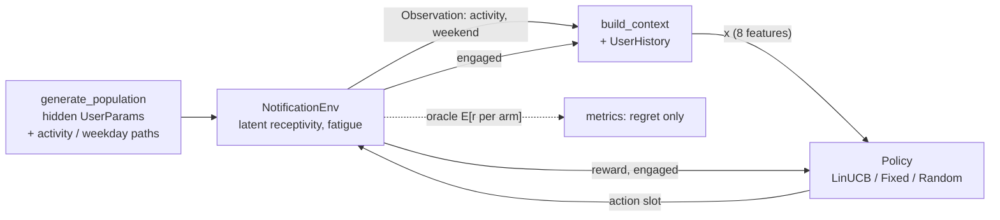

# Adaptive Notification Timing via Contextual Bandits for Human-AI Interaction

A small, reproducible research prototype. A simulated health app sends each user one
behavioral nudge per day (walk, hydrate, exercise). A **Disjoint LinUCB** contextual
bandit learns *when* to send it (08:00, 13:00 or 19:00), using only observable context
and interaction history. It is compared with a fixed 19:00 schedule, a random schedule,
and a context-free LinUCB ablation.

> **Synthetic simulation only.** All users, behaviors and outcomes are generated by a
> hand-designed simulator. The results say nothing about clinical effectiveness or how
> real people would respond.

## 1. Problem and motivation

Nudges only help if people act on them. The same reminder can be welcome at lunch and
annoying at 08:00. When nudges are ignored repeatedly, users get fatigued: they become
less receptive and may disable notifications altogether. The question is whether an
online learner can personalize timing from engagement feedback, and so raise engagement
while lowering fatigue.

## 2. Why static schedules are insufficient

A fixed schedule picks one slot for everyone. Users differ in preferred time, some shift
preference on weekends, and active days favor midday nudges. A single slot is therefore
wrong for a large share of the population on most days. Each mistimed nudge costs an
engagement and adds fatigue, and that fatigue lowers future engagement.

## 3. Architecture and data flow



| File | Responsibility |
|---|---|
| `config.py` | Defaults + CLI overrides |
| `environment.py` | User population, latent receptivity, fatigue, engagement, reward |
| `context.py` | Observable feature construction (no leakage) |
| `agents.py` | Disjoint LinUCB + intercept-only ablation |
| `policies.py` | Fixed and random baselines |
| `train.py` | Online interaction loop (used for training and evaluation) |
| `evaluate.py` | Training, multi-seed matched evaluation, seed management |
| `metrics.py` | Metrics, aggregation, regret, relative improvement |
| `plot_results.py` | Figures from CSVs |
| `run_experiment.py` | End-to-end entry point |

## 4. Observable context vs. latent receptivity

The agent sees an 8-dimensional context, with every value in [0, 1]:

| # | Feature | Definition (default before any history) |
|---|---|---|
| 0 | bias | 1 |
| 1 | activity | today's activity level |
| 2 | is_weekend | 1 on day-of-week 5, 6 |
| 3 | recent_engagement | mean engagement over last 7 notifications (0.5) |
| 4 | recent_ignored | ignored in last 7 / 7 (0) |
| 5–7 | slot_eng_{morning,afternoon,evening} | (engagements + 1) / (sends + 2) for that user and slot (0.5) |

A count of notifications in the last 3 days was left out. Every user gets exactly one
notification per day, so that count would be a constant.

The environment's **hidden** state is: per-user parameters, *receptivity* r (a
slowly-drifting willingness to interact) and *fatigue* f (accumulated annoyance). The
agent never sees these. It can only infer them indirectly through the history features.
The current day's outcome is added to the history only *after* the decision is made
(tested in `tests/test_context.py`).

## 5. Environment model

Per user, the hidden parameters are drawn as follows: baseline ~ N(-0.3, 0.5) clipped to
[-2, 1]; preferred slot uniform over {0, 1, 2}; pref_strength ~ U(1, 2.5);
weekend_shift ~ Bernoulli(0.4) (preference moves one slot later on weekends);
activity_sens ~ U(0, 1.5); fatigue_sens ~ U(0.1, 0.6); r0 ~ U(-0.5, 0.5);
trend ~ U(-0.01, 0.01)/day; noise_sd ~ U(0.02, 0.1); activity_mean ~ U(0.2, 0.8).
Daily activity = clip(activity_mean + N(0, 0.15), 0, 1).

**Engagement** for slot a:

```
eff_pref = (preferred_slot + weekend_shift·is_weekend) mod 3
match(a) = 1 − |a − eff_pref| / 2                     ∈ {0, 0.5, 1}
z        = baseline + pref_strength·(match − 0.5)
         + activity_sens·w_a·(activity − 0.5)          w = (−0.5, 1, −0.5)
         + r − fatigue_sens·f
p_engage = clip(σ(z), 0.01, 0.99)
```

**Fatigue event.** This can only happen when the nudge is ignored, and not every ignore
causes one:
`q(a) = clip(σ(−2.5 + fatigue_sens·f + (1 − match)), 0.01, 0.99)`, P(fatigue) = (1 − p)·q.

**State updates** after each decision:

```
f ← clip(0.6·f + ignored + 0.5·fatigue_event, 0, 5)
r ← clip(r + 0.1·(r0 + trend·t − r) + 0.05·engaged − 0.3·fatigue_event + N(0, noise_sd²), −2, 2)
```

So fatigue lowers engagement directly (the −fatigue_sens·f term), raises future fatigue
risk (through q), and lowers receptivity.

## 6. Contextual bandits vs. MAB vs. full RL

* **Multi-armed bandit:** learns one best arm overall. Our intercept-only ablation is
  essentially this.
* **Contextual bandit:** learns the best arm *as a function of context*, which allows
  personalization. Each decision is scored by its immediate reward.
* **Full RL / MDP:** optimizes a discounted long-horizon return through value functions.

Our actions do influence the future, through fatigue. We still use a bandit because the
effect is short-lived and mostly captured by the immediate reward (a mistimed nudge is
ignored now *and* may cause a fatigue event, which is penalized now). The history
features also expose the consequences to the agent. A bandit is simpler, more
sample-efficient and easier to analyze. Its known limitation is that it does not plan
around delayed fatigue.

## 7. Disjoint LinUCB

Each arm a keeps `A_a = λI` and `b_a = 0`. Given context x:

```
θ_a   = A_a⁻¹ b_a
score = xᵀθ_a + α·sqrt(xᵀ A_a⁻¹ x)
a*    = argmax score   (random tie-break)
A_a* += x xᵀ,  b_a* += r x      (only the chosen arm)
```

The bonus is large for arms and context directions that have seldom been tried, so the
agent explores them. It shrinks as data accumulates, after which the agent exploits.
The implementation uses Cholesky solves instead of explicit matrix inverses. One model
is shared across all users; personalization comes from the per-user history features.
Defaults are α = 0.5 and λ = 1. These were set before running the experiments and not
tuned on evaluation results.

## 8. Reward design

Engaged gives +1; ignored gives 0; a fatigue event adds −0.25. Engagement and fatigue are
logged separately. *Limitations:* the weight 0.25 is arbitrary. Engagement is a proxy, not
health benefit. A real system would also need constraints such as a cap on total
notifications.

## 9. Baselines

* **Fixed:** always 19:00 (primary comparison).
* **Random:** a uniform choice among the three slots each day.
* **Ablation, LinUCB (intercept only):** same algorithm, but uses only the bias feature.
  It learns a single population-wide value per slot.

## 10. Experimental protocol

1. **Training:** both LinUCB variants learn online on a separate training population
   (100 users × 60 days).
2. **Evaluation:** 10 seeds. Each seed draws a **fresh, unseen population** (same
   distribution of user types) and its activity/weekday paths. Every policy runs on
   *that same population*. Each policy has its own response random-number generator, so
   the stochastic outcomes differ between policies even though the users are matched.
   Each LinUCB run starts from a copy of the trained weights and **keeps learning online
   during evaluation**, because online adaptation is the point of the system.
3. All seeds come from `numpy.random.SeedSequence([master_seed, stream, ...])`, so the
   same `--seed` reproduces the run exactly (tested).
4. The **seed is the unit of analysis**: results are mean ± sample std over 10 runs.

## 11. Metrics

Engagement rate (engagements / notifications), cumulative reward per user, average reward
per decision, fatigue-event rate, engagements per user, curves over time, and
**simulator-oracle regret**:

```
regret_t = max_a E[r | a, s_t] − E[r | a_t, s_t]
```

Here E[r | a, s] = p_engage(a) − 0.25·(1 − p_engage(a))·q(a), evaluated on the simulator's
true hidden state at the moment of the decision. This is a per-step (myopic) benchmark
that uses oracle knowledge. It **cannot be computed by a real deployed system** and is
used only for analysis here. Relative improvement = 100·(adaptive − fixed)/fixed; it is
NaN if fixed is 0.

## 12. Install, run, test

```bash
python3 -m venv .venv && source .venv/bin/activate   # Python 3.10+
pip install -r requirements.txt
python run_experiment.py                              # full pipeline (~1 min)
python run_experiment.py --users 50 --train-days 30 --seeds 5 --seed 123
python plot_results.py                                # regenerate plots from CSVs
python -m pytest -q                                   # tests
```

Outputs in `results/`: `summary_metrics.csv`, `per_seed_metrics.csv`,
`learning_curves.csv`, `run_config.json`, and five PNG figures.

## 13. Results (default config, `python run_experiment.py`, master seed 42)

Mean ± std over 10 evaluation seeds, 100 users × 60 days each:

| Policy | Engagement rate | Reward / user | Fatigue rate | Oracle regret / user |
|---|---|---|---|---|
| Fixed 19:00 | 0.279 ± 0.025 | 13.66 ± 1.67 | 0.206 ± 0.017 | 9.15 ± 1.10 |
| Random | 0.297 ± 0.016 | 15.17 ± 1.10 | 0.177 ± 0.012 | 8.78 ± 0.22 |
| LinUCB, intercept only | 0.280 ± 0.023 | 13.71 ± 1.47 | 0.205 ± 0.012 | 9.15 ± 1.10 |
| **LinUCB, full context** | **0.420 ± 0.025** | **23.26 ± 1.75** | **0.130 ± 0.017** | **4.51 ± 0.36** |

* Full-context LinUCB has a **+50.4%** relative engagement rate vs. fixed. It also
  produces ~37% fewer fatigue events and about half the oracle regret. Under this
  simulator, it improved engagement *and* reduced fatigue.
* **Ablation:** the intercept-only LinUCB ends up choosing 19:00 on 99% of decisions, so
  it performs almost exactly like the fixed baseline. Without context it can only learn
  one population-level slot, and since preferences are spread evenly across slots, no
  single slot is much better. The gain comes from the per-user history and context
  features, not from bandit learning alone.
* Random beats fixed slightly. A single fixed slot is badly wrong for about 2/3 of users
  every day, while random spreads the mistakes around.

These numbers come from a simulator whose structure I designed. A different simulator
would give different numbers.

## 14. Limitations and extensions

* The user model is hand-crafted. There is no real data, and the parameters are not
  calibrated.
* Only one notification per day, with no "don't send" action. Adding a no-send arm would
  make the fatigue trade-off much richer.
* Bandits are myopic. Long-horizon RL, or a fatigue-aware constraint, could plan around
  delayed effects.
* One model is shared across users, and personalization comes only from features.
  Extensions include hybrid LinUCB (shared + per-user parameters), Thompson sampling,
  non-stationarity handling (discounted or sliding-window LinUCB), and off-policy
  evaluation on logged data.
